## Introduction

In this lab, the STM32L432KC was programmed to act as an internet-connected
thermometer with a remotely controlled LED. A DS1722 digital thermometer is read
over SPI, and an ESP8266 Wi-Fi module serves a web page to any browser that
connects to its access point. From the page, a user can read the current
temperature, turn the on-board LED on and off, and choose the DS1722 resolution
from 8 to 12 bits. The MCU and ESP8266 talk over a UART at 125000 baud. The
ESP8266 sends the MCU a request line for every page load, and the MCU replies
with a complete HTML document. A new SPI driver was written for SPI1, and new drivers were written for USART1
and for the DS1722.

## Design and Testing Methodology

### Hardware

The circuit has three parts, shown in the Schematic in Figure 1.

- The DS1722 is powered from 3.3 V on both its digital supply and
  its analog supply. It is wired in SPI mode by tying SERMODE
  to VDDD. SCLK is on PA5, SDI is PB5, SDO is PA6, and the chip enable CE is PB0. 
  SCLK, PB5, and PA6 are the SPI1 pins while CE is GPIO since it is active high. 
- The ESP8266 click board is powered from 3.3 V. Its TX goes to the MCU RX
  on PA10 and its RX goes to the MCU TX on PA9.
- The on-board LED is PB3.

### SPI Driver

The SPI driver is initSPI() and spiSendReceive() in STM32L432KC_SPI.c.
initSPI() takes the clock divider and the clock polarity and phase, so the
same driver can talk to a device with a different mode. It works following these steps

1. Turn on the SPI1 clock (RCC_APB2ENR.SPI1EN) and read the register back
2. Set the alternate function to AF5 on all three pins before switching them to
   alternate-function mode.
3. Write SPI1->CR1 with the clock divider (BR), CPOL and CPHA, MSTR, and
   SSM and SSI. The bit order stays MSB first.
4. Write SPI1->CR2 for 8-bit frames (DS = 0b0111) and set FRXTH so RXNE is set
   after 8 bits instead of 16.
5. Set SPE last.

spiSendReceive() waits for TXE, writes one byte to DR, then waits for RXNE and
returns the received byte. DR is accessed through a byte pointer, because a
16-bit write would queue two 8-bit frames.

### DS1722 Driver

A DS1722 transaction is CE high, an address byte, one or more data bytes, and CE
low. Bit 7 of the address selects a write.

| Register | Read address | Write address |
|---|---|---|
| Configuration | 0x00 | 0x80 |
| Temperature LSB | 0x01 | not writable |
| Temperature MSB | 0x02 | not writable |

The configuration register holds the resolution in bits R2 to R0, and 8 to 11
bits are R = 0 to 3, while 12 bits is R = 4. The SD bit is kept at 0 so the
sensor converts continuously. The driver does the following

- ds1722SetResolution() writes the configuration, then reads it back.
- ds1722ReadTemp() does a burst read. The LSB and MSB come from the same transaction. 
  The 16-bit value is two's complement with 8 fractional bits, so
  the temperature is the signed value divided by 256.
- Bits below the selected resolution are cleared with a mask. A reading taken
  before the resolution was lowered would otherwise show extra bits.

### Web Server

The ESP8266 sends a request line of the form /REQ:tag followed by a newline for
every page load. The main loop in main.c waits for one line with readChar(),
updates its state from the tag, then sends the whole page with sendWebpage(). The
three tags are:

- ledon and ledoff set the LED.
- res?bits=N sets the DS1722 resolution if N is from 8 to 12. Any other value is ignored.
- an empty tag or anything else change nothing

The page always starts with the doctype and ends with the closing html tag, since
the ESP8266 forwards it as soon as it sees that tag. It is sent as plain strings
over USART1. The page has three sections: the temperature, with as many decimal
places as the resolution has (1, 0.5, 0.25, 0.125, 0.0625 °C), a drop-down form
to choose the resolution, and two buttons for the LED, with a line that
says whether it is on or off. The page does not update itself, so the user reloads
it for a new reading. If the DS1722 does not answer, the temperature reads "--"
and the MCU tries to configure it again at every request, so it recovers if the
sensor is plugged in later.

At startup the MCU sets the resolution to 12 bits, and waits for the first
conversion with the TIM2 delay timer, so the first page already has a real
reading.

## Technical Documentation

The source code for this lab can be found in this
[GitHub repository](https://github.com/GabeAlencar/hmc-e155-portfolio/tree/main/labFiles/lab6).

### Calculations

#### SPI clock

The SPI1 clock is the 16 MHz system clock, and BR = 0b010 divides it by
$2^{BR+1} = 8$:

$$
f_{SCLK} = \frac{16\ \text{MHz}}{2^{2+1}} = 2\ \text{MHz}
$$

This is under the DS1722 maximum of 5 MHz. The DS1722 shifts data in on the
falling edge and changes its output on the rising edge, which is CPOL = 0 and
CPHA = 1.

#### UART baud rate

USART1 is clocked from HSI16. With 16x oversampling,

$$
BRR = \frac{16\ \text{MHz}}{125000} = 128
$$

which is exactly 125000 baud, so there is no baud rate error against the ESP8266.

#### Temperature format and range

The two temperature registers form a 16-bit two's complement number in units of
1/256 °C. Two examples at the ends of the required range are

$$
\text{0x1E00} = \frac{7680}{256} = +30\ \text{°C}
\qquad
\text{0xF600} = \frac{-2560}{256} = -10\ \text{°C}
$$

The raw value is converted as a signed 16-bit integer, so negative temperatures
come out correctly.

#### Resolution and conversion time

| Resolution (bits) | R2 R1 R0 | Step (°C) | Decimals on page |
|---|---|---|---|
| 8 | 000 | 1 |  0 |
| 9 | 001 | 0.5 | 1 |
| 10 | 010 | 0.25 | 2 |
| 11 | 011 | 0.125 | 3 |
| 12 | 1xx | 0.0625| 4 |

The supported range is

$$
T_{min} = \text{0xF600} = -10\ \text{°C}
\qquad
T_{max} = \text{0x1E00} = +30\ \text{°C}
$$

Both end points have a lower byte of 0x00, so every resolution from 8 to 12 bits
represents them exactly. At 8 bits the reading is accurate to 1 °C, and at 12 bits to 0.0625 °C.
The sensor itself powers up in 9-bit shutdown mode, so the driver writes the configuration at startup. The page starts at 12 bits, which gives the best accuracy.
After a resolution change the sensor needs up to one conversion time before the
reading has the new precision. The MCU does not wait, since the ESP8266 gives up if the
reply starts more than 200 ms late. The page tells the user to reload.

### Schematic

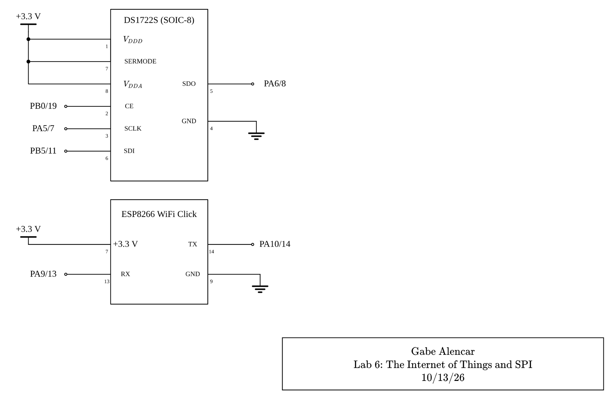

Figure 1 shows the circuit built on the breadboard. See the
[E155 development board schematic](https://hmc-e155.github.io/assets/doc/E155%20Development%20Board%20Schematic.pdf)
for how the MCU pins reach the breadboard and for the on-board LED.

### SPI Logic Analyzer Capture

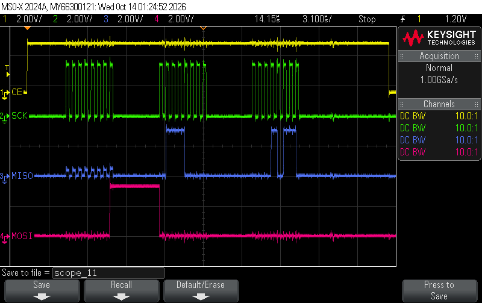

Figure 2 shows a full read of the temperature registers, captured with
the logic analyzer on the Digital Lab oscilloscope.
#### Timing against the datasheet

Each of the timing parameters in the datasheet's SPI characteristics was measured with cursors. Every value is inside the datasheet limit.

| Parameter | Meaning | Measured | Datasheet limit | Within spec |
|---|---|---|---|:---:|
| tCLK | SCLK frequency | 2.000 MHz | 5 MHz | ✓ |
| tCL | SCLK low time | 248 ns | min 100 ns | ✓ |
| tCH | SCLK high time | 252 ns | min 100 ns | ✓ |
| tR, tF | SCLK rise and fall time | 17 ns, 17 ns | max 200 ns | ✓ |
| tCC | CE high to first SCLK rising edge | 3.198 µs | min 400 ns | ✓ |
| tCCH | last SCLK falling edge to CE low | 7.2 µs | min 100 ns | ✓ |
| tCWH | CE low time between transactions | 7.759 µs | min 400 ns | ✓ |
| tDC | MOSI valid to SCLK sampling (falling) edge | 264 ns | min 35 ns | ✓ |
| tCDH | MOSI hold after SCLK sampling (falling) edge | 250 ns | min 35 ns | ✓ |
| tCDD | SCLK rising edge to MISO valid | 36 ns | max 80 ns | ✓ |
| tCDZ | CE low to MISO released | 33 ns | max 40 ns | ✓ |

::: {.callout-note collapse="true"}
## Zoomed captures used for each measurement

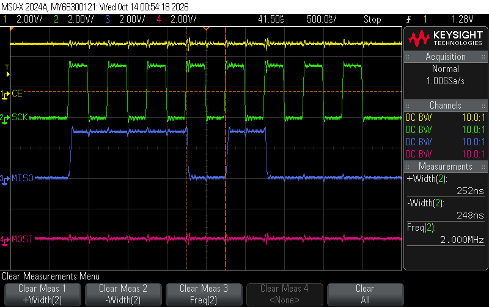

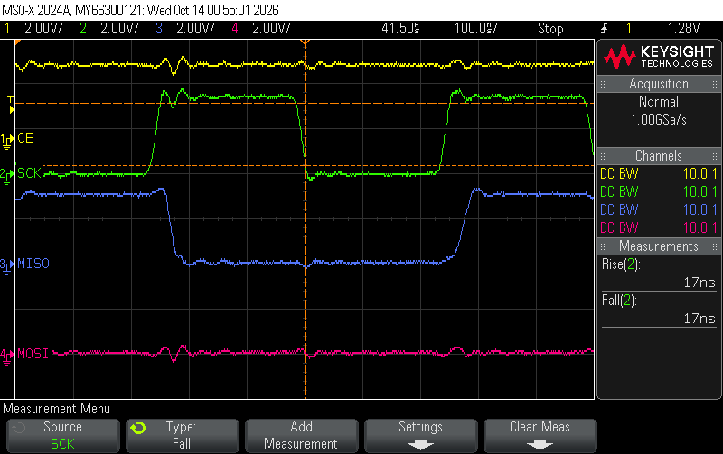

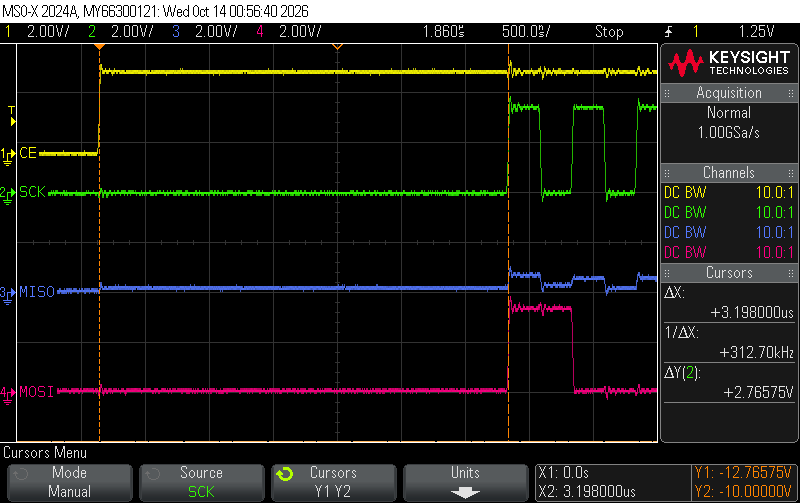

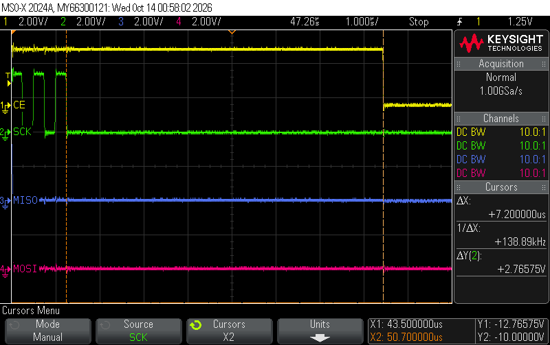

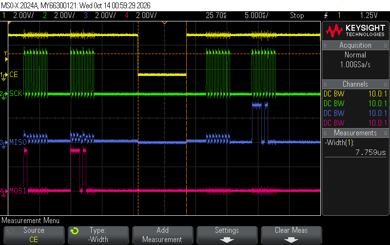

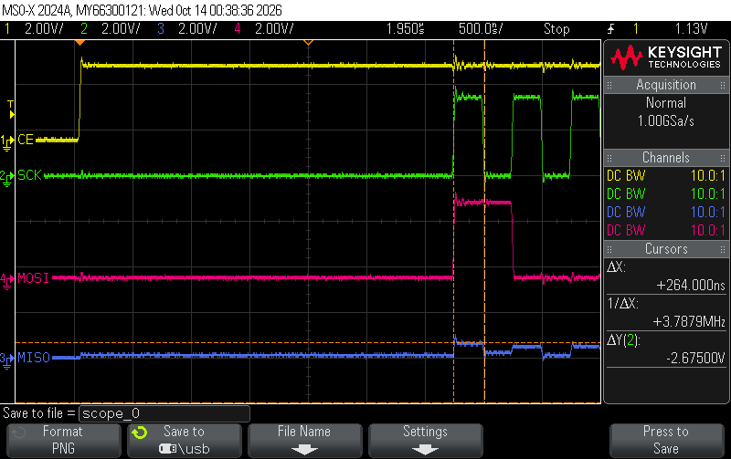

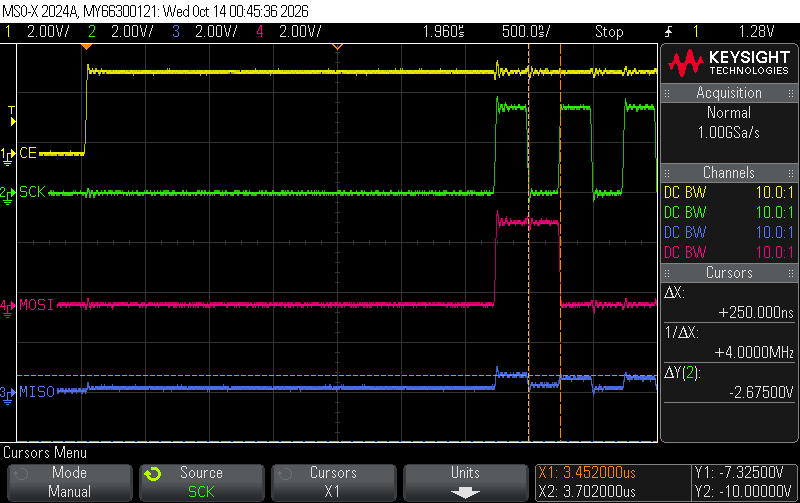

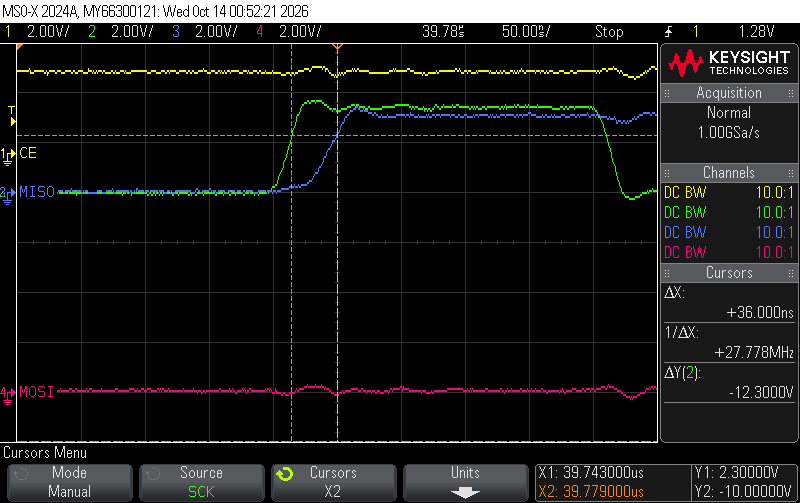

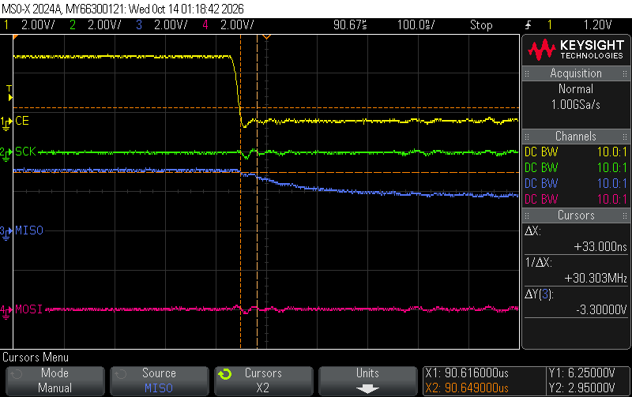

:::

The waveforms show the timing meets all the SPI parameters from the DS1722 datasheet.

## Results and Discussion

Overall, the design meets all the requirements. The ESP8266 serves a page that shows
the DS1722 temperature, reports the LED state, and has buttons to change it. The
resolution can be set to 8, 9, 10, 11, or 12 bits from the page, and the driver
reconfigures the sensor to match. The SPI capture shows a complete read with CE, SCK, MISO,
and MOSI. I spent a total of 15 hours working on this lab.

## AI Prototype Summary

For this lab's AI prototype, I asked Gemini for a web page for the
temperature and LED, and C code to read the DS1722 over SPI. Neither output could
be dropped into my project but the SPI code was much closer than the web page.

The SPI code got a lot right. It used the correct register addresses, it knew the DS1722 needs 
CPHA = 1, and it identified that CE is active high. It had two real bugs, though.
First, it never writes the configuration register. The DS1722 powers up in shutdown
mode, so without a write to 0x80 the sensor does not convert correctly. It also never sets the resolution.
Second, the negative temperature handling is wrong. The two bytes form a single
two's complement number, so the temperature is just the signed MSB plus the
fraction. The code instead computes integer and fractional parts incorrectly.

The web page looks good, but it is the wrong kind of solution. It is a self-contained
page with JavaScript that simulates the sensor using random noise, toggles the LED
indicator only in the browser, and uses a "precision" slider that only changes the number of
decimals displayed. None of it talks to the MCU. The lab needs the page to be a plain HTML form,
sent over USART1 by the MCU. It is also large, around 9 KB, which at 125000 baud
would take several hundred milliseconds to send, longer than the 200 ms the ESP8266 will
wait for a reply. My page is a short string of plain HTML and fits well within that time.

Overall, the AI was good at the register-level facts, but it missed the overall system. 
Next time, I would include the full system description in the first prompt, including the ESP8266 request protocol, 
the page size limit, and the range of temperatures that need to work.
