## Introduction

In this lab, a hardware accelerator for 128-bit AES encryption was built on the
FPGA. The STM32L432KC sends a 128-bit plaintext and a 128-bit key to the FPGA
over SPI, the FPGA encrypts the plaintext, and the MCU reads the 128-bit
ciphertext back over SPI and compares it with the known answer from FIPS-197
Appendix B. The MCU turns on the PA9 LED if all 16 bytes match and the PA10 LED
if they do not.

The AES standard (FIPS-197) with Nk = 4, Nb = 4, and Nr = 10 was implemented.
The starter code supplied the top-level module, the SPI shift register, the
S-box RAM, MixColumns, and the MCU program. The control FSM, the datapath, SubBytes, ShiftRows,
AddRoundKey, and key expansion were written for this lab, as well as a
synchronizer for the load input. As in the previous labs, the design was written in SystemVerilog, simulated in
QuestaSim, and synthesized in Lattice Radiant for the iCE40 UP5K.

## Design and Testing Methodology

### Design Overview

The full ten rounds of AES in one combinational block would be too large for
the chip, so the design is sequential. It keeps a 128-bit state register and a
128-bit round key register and does one round at a time. A round is two clock
cycles because the S-box is a synchronous RAM, which gives the byte on its output
one clock cycle after the address.

- Cycle 1 (SUB): the state and key are read from the S-box RAMs. SubBytes
  uses 16 S-boxes (one per state byte) and the key expansion uses 4 more (one per
  byte of RotWord).
- Cycle 2 (ROUND): the S-box outputs are valid. The datapath applies ShiftRows
  and MixColumns, expands the next round key, and XORs the two together. The result goes
  to the state register and the new key goes to the key register. The last round
  skips MixColumns.

The total design takes 2 clock ticks for synchronization, 1 for LOADING, 1 for INIT, and 2 for each of the 10 rounds, for a total of 24 clock ticks from the falling edge of load to done.

### SPI Interface and Load Handling

The MCU sends data with SPI mode 0 (CPOL = 0, CPHA = 0), MSB first. It raises load, sends
the 16 plaintext bytes and then the 16 key bytes, and lowers load. It waits for
done, then clocks out 16 bytes, which the FPGA shifts out. The SPI shift register and the output timing are the
starter code.

The core uses load for two jobs: start and reset. The computation begins when load falls. The testbenches have no 
reset input, so while load is high the FSM is forced into its LOADING state. Load is not synchronous to the 48 MHz clock,
so the design passes it through a two-flop synchronizer.

### Modules

From the starter code:

- aes_spi.sv: The SPI shift register.
- sbox_sync.sv: The synchronous S-box.
- mixcolumns.sv, mixcolumn.sv, galoismult.sv: MixColumns and the multiply by x in
  GF(2^8). galoismult is also used to generate the round constant.
- input_to_state.sv, state_to_output.sv: Convert between the 128-bit packing and a
  4x4 state array

New:

- lab7_GA.sv: The top level with only the HSOSC clock and the aes module.
- aes.sv: The course's top-level module that connects aes_spi and aes_core, and synchronizes load.
- synchronizer.sv: A two-flop synchronizer with no reset.
- aes_core.sv: Connects the control FSM to the datapath.
- aes_ctrl.sv: The control FSM and round counter.
- aes_datapath.sv: The state, round key, and round constant registers, with one round of logic.
- subbytes.sv: 16 sbox_sync instances.
- shiftrows.sv: ShiftRows, using the state array modules.
- keyexpand.sv: One step of the key schedule, with 4 sbox_sync instances for SubWord.
- addroundkey.sv: A 128-bit XOR, used for round 0 and for the end of every round.

### FSM

aes_ctrl is a canonical Moore FSM with one-hot encoding. There is no reset input, because
load takes its place. A 4-bit counter holds the round number from 1 to 10,
and last_round selects the final round.

```{mermaid}
%%| fig-cap: "Figure 1: aes_ctrl state diagram"
stateDiagram-v2
  direction LR
  [*] --> LOADING: load high
  LOADING --> INIT: load low
  INIT --> SUB
  SUB --> ROUND
  ROUND --> SUB: not last_round
  ROUND --> DONE: last_round
  DONE --> DONE
```

| State | Datapath action | Outputs |
|---|---|---|
| LOADING | Held while load is high | none |
| INIT | state <= plaintext ^ key, round key <= key, rcon <= 01, round <= 1 | init_en |
| SUB | S-box RAMs read the state and the last word of the round key | none |
| ROUND | computes ShiftRows, MixColumns, next key, and AddRoundKey. Registers state, roundkey, rcon doubled, round + 1 | round_en |
| DONE | Ciphertext is held in the state register | done |

### Round

- State packing: the state register uses the layout in the starter code. Each
  32-bit word is a column of the state, and S[r][c] is bits [127 - 8*(r + 4*c) -: 8].
- ShiftRows: row r of the array moves left by r bytes, t[r][c] = s[r][(c + r) % 4].
- MixColumns: each column is multiplied by the fixed AES matrix using galoismult. The last round skips it.
- AddRoundKey: the round output is XORed with the next round key, round_state = round_out ^ nextkey.
- Key expansion: with the round key as words w0 to w3, temp = SubWord(RotWord(w3)) ^ {rcon, 24'b0},
  then n0 = w0 ^ temp, n1 = w1 ^ n0, n2 = w2 ^ n1, and n3 = w3 ^ n2. The round constant starts at 01 and is doubled in GF(2^8) every round with galoismult.
- S-box latency: the S-box address comes straight from the state and the round
  key registers from SUB.

## Technical Documentation
The source code and testbenches for this lab can be found in this [GitHub repository](https://github.com/GabeAlencar/hmc-e155-portfolio/tree/main/labFiles/lab7).

### Block Diagrams

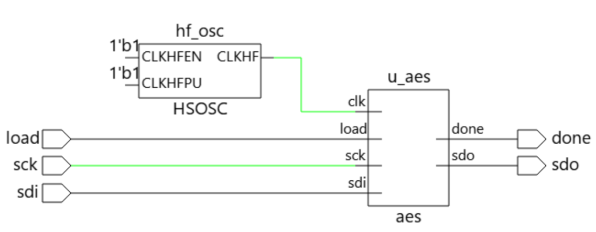

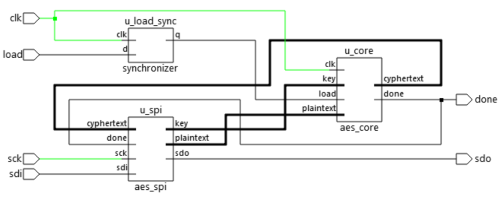

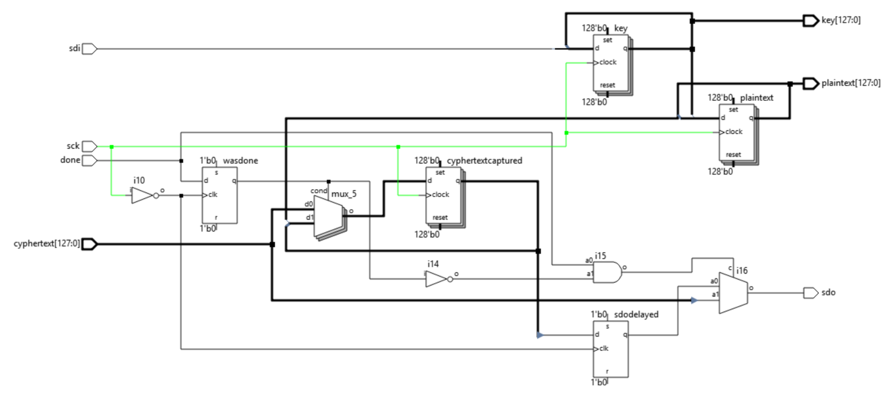 = 

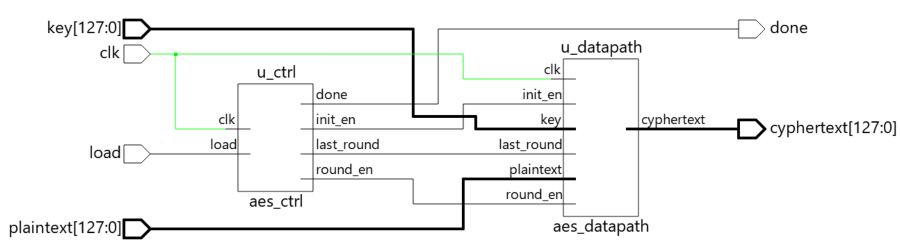

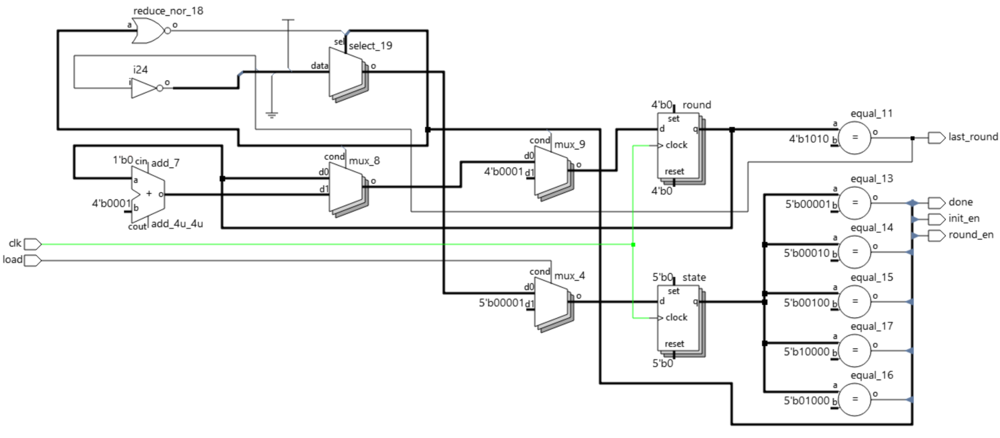

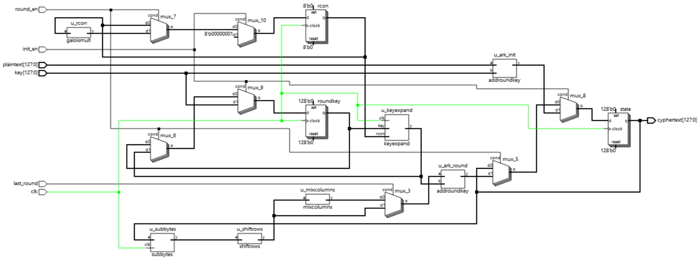

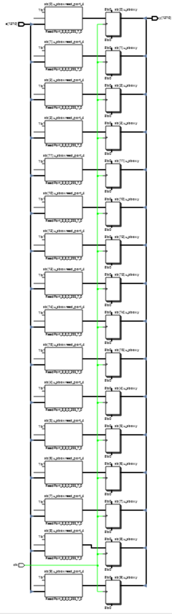

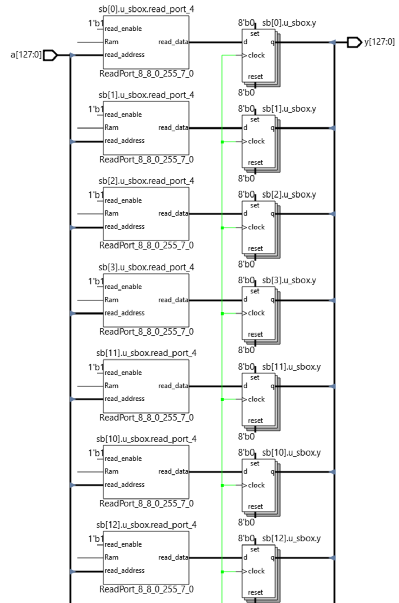

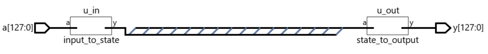

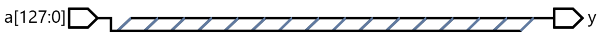

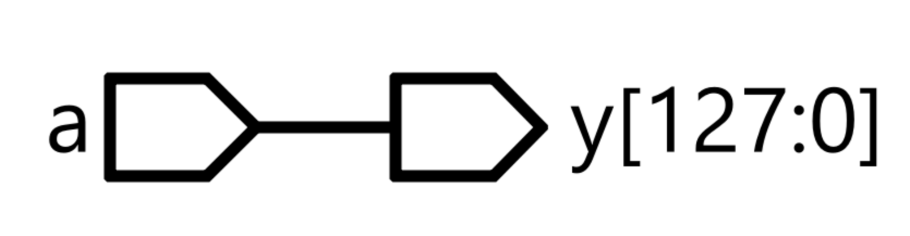 

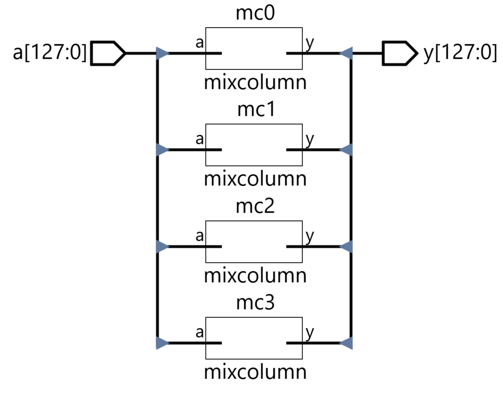

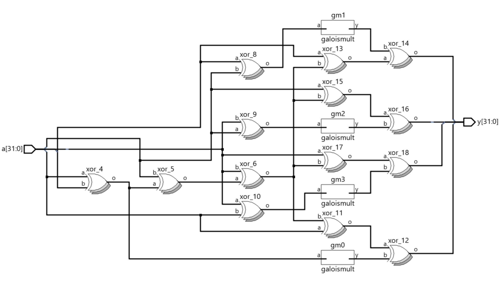

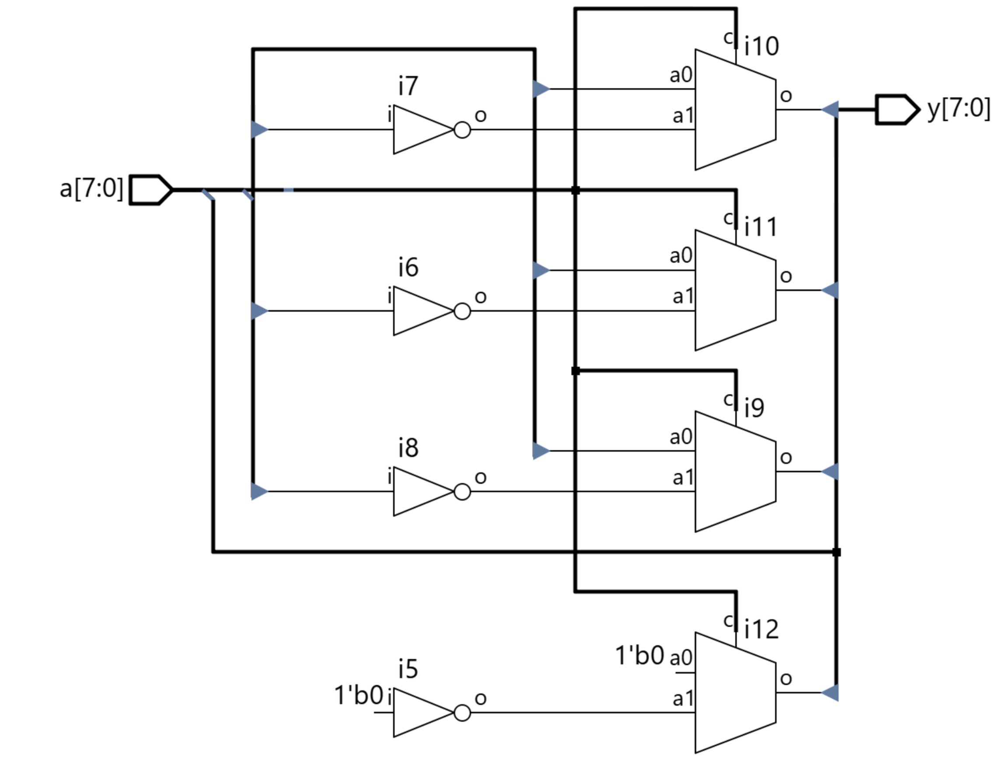

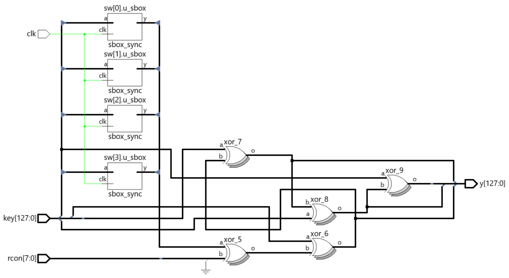

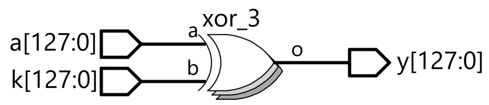

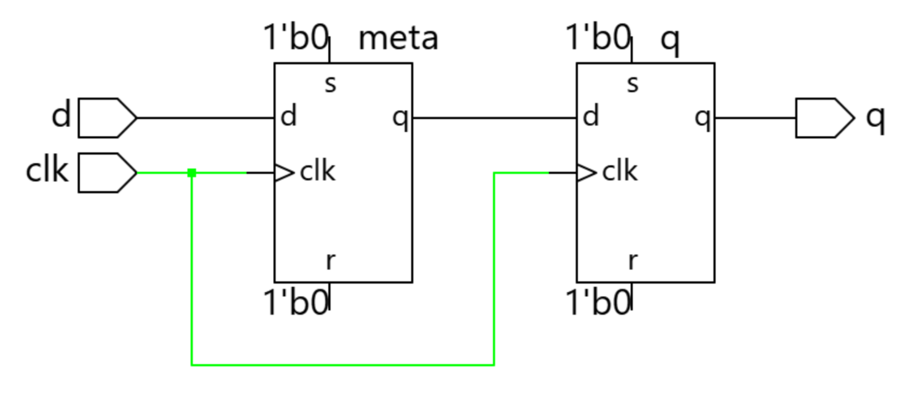

### Calculations

#### Latency

With a clock period $T$, the time from the falling edge of load to done is the two-flop
synchronizer, the LOADING cycle, the INIT cycle, and two cycles for each of ten rounds, which is 24 clocks:

$$
t_{done} = (2 + 1 + 1 + 2 \cdot 10)\,T = 24\,T
$$

At 48 MHz this is 24 x 20.8 ns = 0.5 µs.


### Logic Analyzer Capture

In the first part, with load high, the MCU sends the 32 bytes of plaintext and key.
The second part is where the 16 ciphertext bytes are read out.


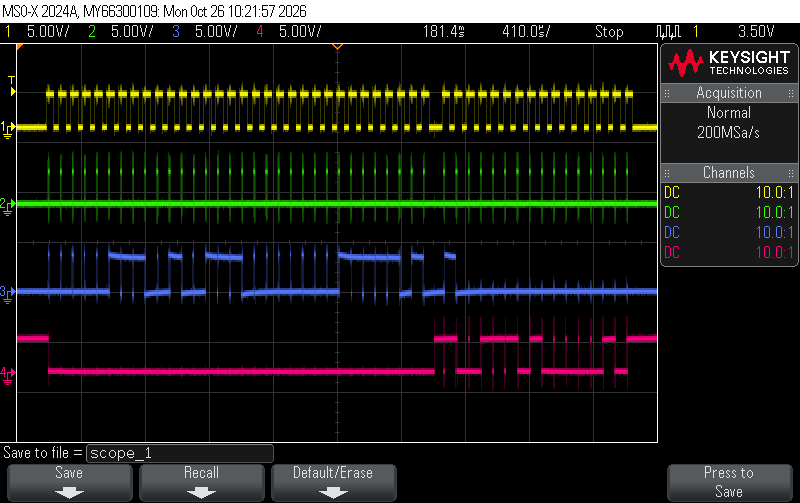


## Results and Discussion

The design was programmed onto the FPGA and the MCU was loaded with lab7.c. After a reset, the PA9
success LED (D3) came on immediately, and the PA10 failure LED stayed off. That means the 16
bytes the FPGA returned were the same as the FIPS-197 Appendix B ciphertext.

### Testbench Simulation

The testbenches were run in QuestaSim with the plaintext from FIPS-197 Appendix B. Before the whole
design was put together, each step was simulated against the Appendix B values. All of these
passed.

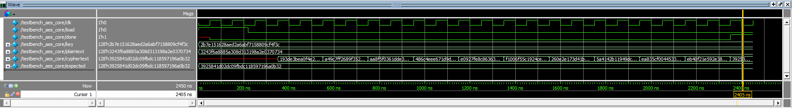

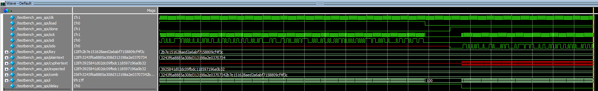

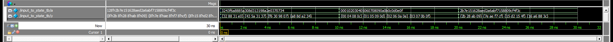

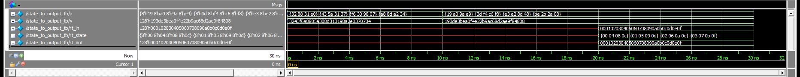

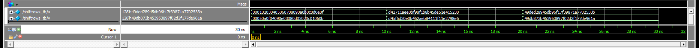

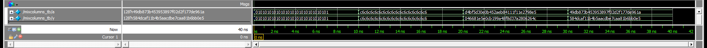

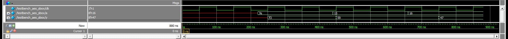

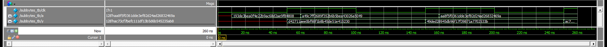

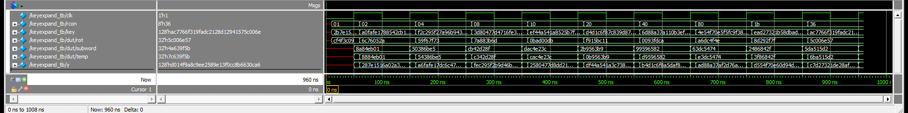

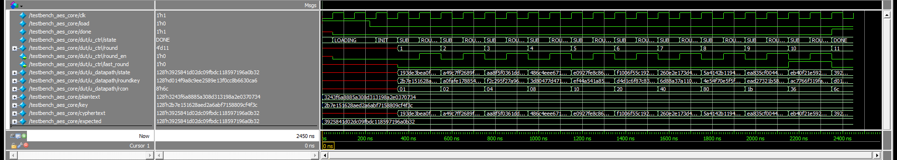

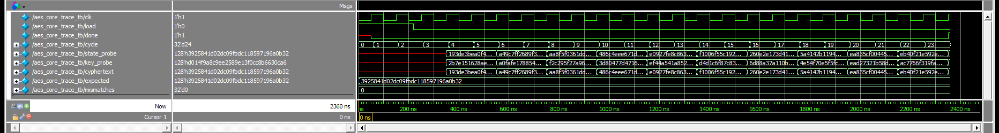

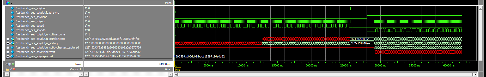

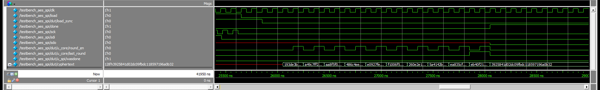

## Conclusion

The design meets the lab requirements. A complete AES-128 encryption is performed in hardware
on the FPGA, from a plaintext and key that arrive over SPI, and the result is read back and verified by the
MCU against the FIPS-197 vector. AES is split into modules for each step, with the control FSM kept
apart from the datapath, and the S-box latency is handled by the SUB state. All testbenches pass
and all modules matched the Appendix B values. I spent a total of 15 hours on this lab.

## AI Prototype Summary

For this lab's AI prototype, I gave Gemini the two KeyExpansion prompts from the prototype page, each in a new
chat with no other context. Prompt A had the FIPS-197 key expansion section attached as the page's image, and Prompt B had only the
pseudocode. Prompt A gave a single-step key_expansion module with a prev_key and round input. It looks up Rcon in a case statement, instantiates rotword and subword, and chains n0 to n3 with XORs, which is almost the same structure as my keyexpand. Looped
over 10 rounds it produced d014f9a8c9ee2589e13f0cc8b6630ca6, the last round key in Appendix A.1. Prompt B gave a
parameterized KeyExpansion with Nk and Nr, a generate loop with if and else if branches that build all 44 words at once,
and an unpacked array of words. Its last four words also matched Appendix A.1

Withholding the specification did not change whether the HDL was correct, but it changed what kind of HDL I got. A
produced one round key per call and used the round number, which is what the page asked for and what the datapath needs. B
produced the whole schedule combinationally with the loop unrolled, which is more general. The AI could not know that detail of my hardware. Next time I would give the model the S-box timing and the packing of the key and state up front, and then check the output against the Appendix A.1 test vector.